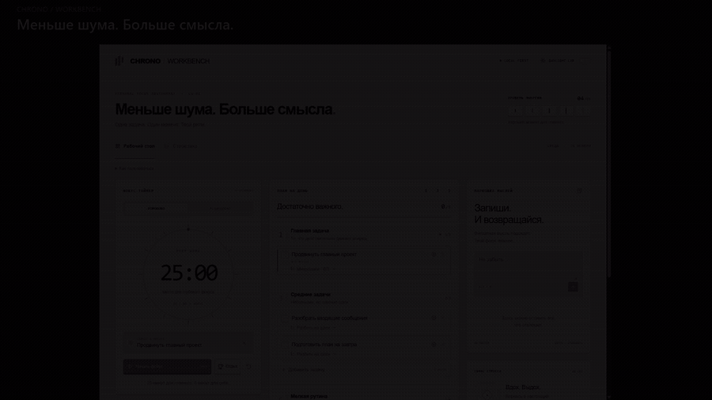
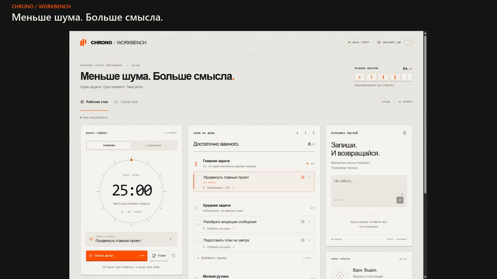
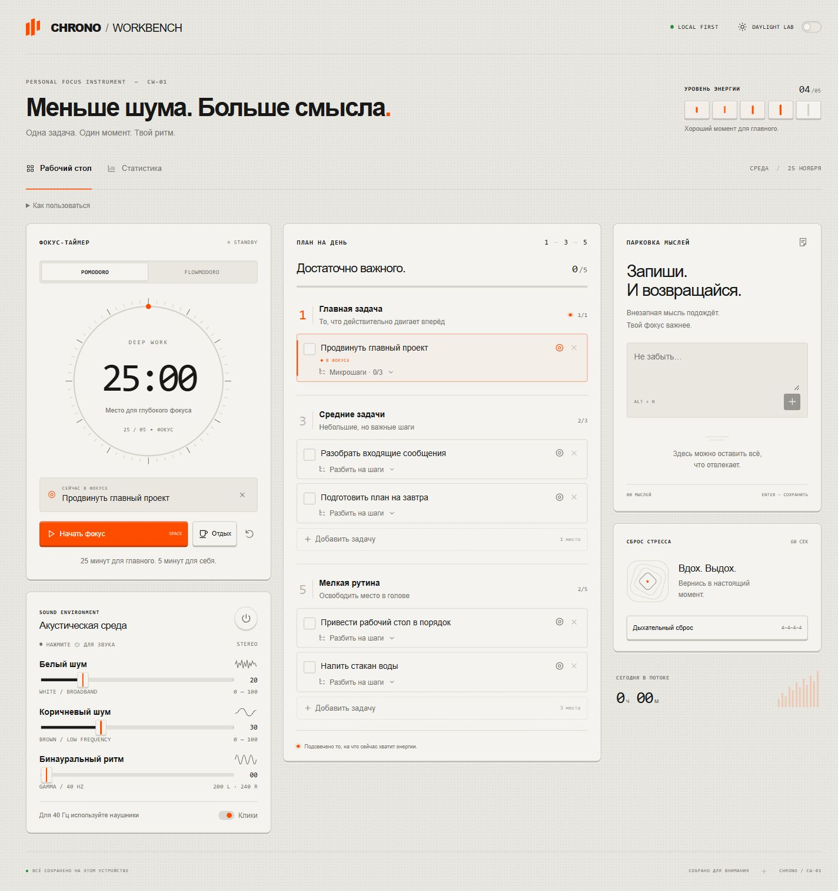
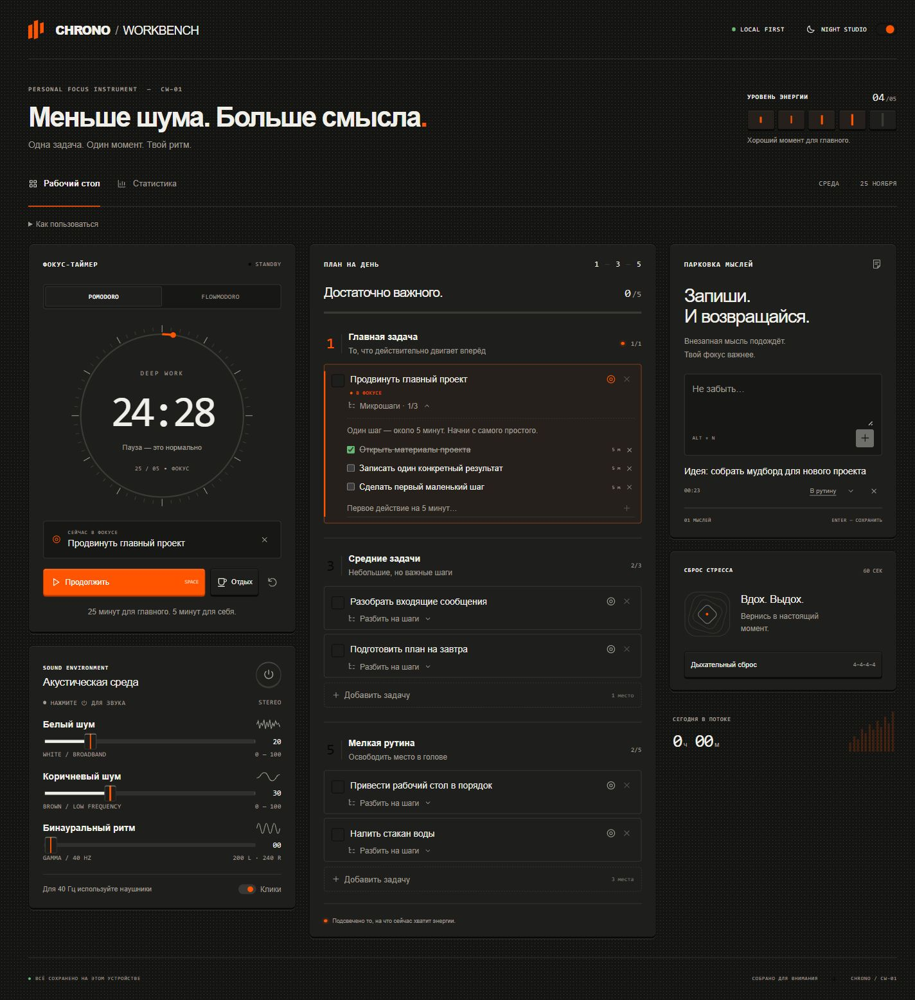
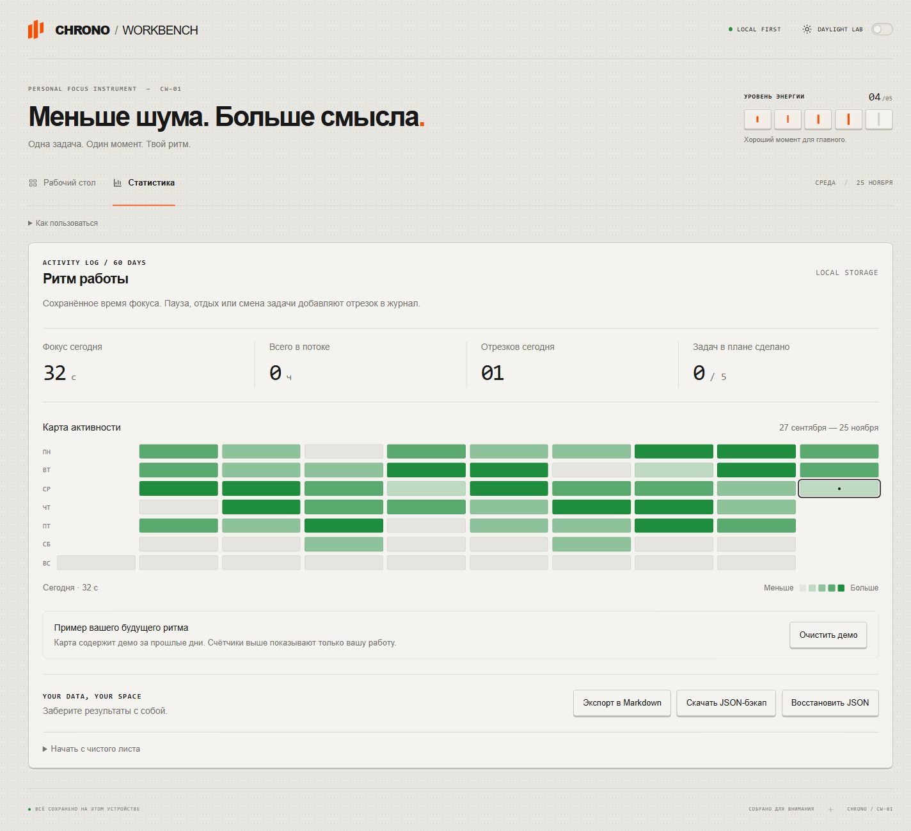
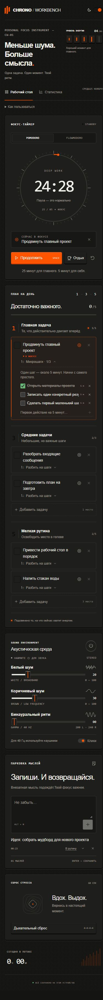

<div align="center">

# CHRONO-WORKBENCH

**Локальная рабочая станция для глубокого фокуса.**

Одна задача · Свой ритм · Меньше отвлечений

React 19 · TypeScript · Vite · Web Audio · Хранение в браузере

[](https://rostislav-565.github.io/chrono-workbench/promo/)

**[Открыть приложение](https://rostislav-565.github.io/chrono-workbench/)** · **[Смотреть видео](https://rostislav-565.github.io/chrono-workbench/promo/)** · **[Исходный код](src/)**

</div>

## Для чего это нужно

CHRONO-WORKBENCH помогает выбрать главное, начать с небольшого действия и удерживать внимание. На одном рабочем столе находятся таймер, план на день, парковка мыслей, звуковой микшер и короткий дыхательный тренажёр.

Интерфейс похож на настольный прибор: матовый корпус, круговая шкала, механические кнопки, сигнальный оранжевый и две темы — **Daylight Lab** и **Night Studio**. Графика, звуки и диаграммы создаются в браузере, без внешних библиотек интерфейса и аудиофайлов.

При первом запуске план и заметки пустые. Задачи и показатели на иллюстрациях подготовлены для демонстрации и не становятся вашими данными.

## Как пользоваться

| Модуль | Что делать |
| --- | --- |
| **План 1–3–5** | Добавьте одну главную, до трёх средних и до пяти мелких задач. Нажмите название для редактирования, прицел — для выбора активного фокуса. |
| **Микрошаги** | Нажмите «Разбить на шаги» и запишите действия примерно на пять минут. Их можно редактировать, отмечать и удалять. |
| **Pomodoro** | Начните 25 минут работы. После завершения таймер подготовит 5 минут отдыха; нажмите «Начать отдых». Кнопка «Отдых» запускает перерыв сразу. |
| **Flowmodoro** | Работайте без фиксированного лимита. «Отдых» сохранит фокус и запустит перерыв по формуле `время работы / 5`. |
| **Парковка мыслей** | Запишите отвлекающую мысль, чтобы вернуться к задаче. Позже перенесите её в свободное место плана или удалите. |
| **Энергия** | Выберите уровень от 1 до 5. При высокой энергии подсвечивается главная задача, при средней — средние, при низкой — рутина и дыхательный сброс. |
| **Микшер** | Включите питание и настройте белый шум, коричневый шум и бинауральный ритм. Механические клики включаются отдельно. |
| **Дыхание** | Откройте минутный сброс: вдох, задержка, выдох, пауза — по четыре секунды. Рабочий таймер приостанавливается. |
| **Статистика** | Посмотрите сохранённые отрезки фокуса и тепловую карту за 60 дней. Скачайте отчёт Markdown или JSON-бэкап. |

Выполненные задачи продолжают занимать места в плане; удаление освобождает место. Завершение активной задачи сохраняет её время, останавливает фокус и снимает выбор задачи. Смена активной задачи сохраняет общий отсчёт таймера и записывает отдельный отрезок работы.

### Горячие клавиши

- **Space** — начать или приостановить таймер, когда курсор находится вне полей и интерактивных элементов. На кнопках пробел выполняет обычную клавиатурную активацию.
- **Alt+N** — перейти к парковке мыслей.
- **Enter** — сохранить мысль; **Shift+Enter** — добавить строку.
- **Escape** — закрыть дыхательный модуль или отменить редактирование задачи.

## Видео

[](https://rostislav-565.github.io/chrono-workbench/promo/)

**[Смотреть со встроенным плеером](https://rostislav-565.github.io/chrono-workbench/promo/)** · [Открыть MP4](public/media/chrono-workbench-promo.mp4)

Видео: 30 секунд, Full HD, H.264. Это монтаж реальных экранов приложения с демонстрационными данными. Он показывает таймер, задачи, звуковой микшер, дыхательный сброс, статистику и смену темы. При первом запуске задачи, заметки и история пустые.

## Скриншоты

### Рабочий стол



### Night Studio



### Статистика



### На телефоне



## Данные и резервные копии

Задачи, микрошаги, заметки, тема, энергия, настройки звука и статистика автоматически сохраняются в `localStorage` текущего браузера. Регистрация, серверная база данных и внешние AI API не нужны. Данные рабочего стола не отправляются на сервер.

Хранилище привязано к адресу и профилю браузера. GitHub Pages, `localhost`, `127.0.0.1`, другой порт и приватное окно имеют отдельные данные. Автоматической синхронизации между устройствами нет.

- **Markdown** — читаемый отчёт дня для Notion, Obsidian или личного архива.
- **JSON-бэкап** — полный снимок для резервного хранения и переноса. Импорт принимает проверенный бэкап; восстановленный таймер нормализуется и остаётся остановленным, звук выключается.
- **Начать с чистого листа** — в статистике сначала скачайте JSON-бэкап, затем раскройте блок очистки и подтвердите сброс. Очистка данных сайта средствами самого браузера не создаёт бэкап.

Статистика считает сохранённые отрезки работы; текущий несохранённый отсчёт показан отдельно. Один Pomodoro может состоять из нескольких отрезков. Работа через полночь распределяется по локальным датам. Пауза, сброс таймера и смена режима сохраняют уже отработанное время.

Закрытие вкладки само по себе не останавливает запущенный таймер: при возвращении он сверяется с системным временем. Чтобы закончить работу, нажмите паузу, «Отдых» или сброс. Звуковые сигналы в закрытой вкладке не воспроизводятся.

## Звук и дыхание

Белый и коричневый шум синтезируются через Web Audio. Бинауральный канал подаёт 200 Гц в левое ухо и 240 Гц в правое; разница составляет 40 Гц. Для раздельных каналов нужны стереонаушники.

Браузер разрешает звук после действия пользователя. После перезагрузки снова включите микшер. Уровни громкости и настройка кликов сохраняются.

Дыхательный сброс длится 60 секунд и приостанавливает фокус. После него нажмите «Продолжить», когда будете готовы. Звук подсказок можно выключить; закрыть модуль можно в любой момент.

## Запуск локально

Рекомендуется Node.js 24 и npm. Зависимости зафиксированы в `package-lock.json`.

```bash
git clone https://github.com/Rostislav-565/chrono-workbench.git
cd chrono-workbench
npm ci
npm run dev
```

Откройте [http://localhost:5173/](http://localhost:5173/). Для остановки сервера нажмите `Ctrl+C` в терминале.

В Windows после установки зависимостей можно запустить [START.cmd](START.cmd). Не открывайте `index.html` напрямую: приложению нужен HTTP-сервер. После установки зависимостей локальный запуск не требует интернета.

## Проверки и сборка

```bash
npm test
npm run build
```

Тесты используют встроенный `node:test` и проверяют таймер, паузы, переходы фаз, работу через полночь, учёт задач, хранилище, экспорт, Web Audio и дыхание. Проверка TypeScript входит в `npm run build`.

Готовые файлы находятся в `dist/`. Для локальной проверки сборки:

```bash
npm run preview
```

Предпросмотр использует порт 5173; предварительно остановите dev-сервер. Относительные пути сборки позволяют размещать приложение в подкаталоге. Workflow [deploy.yml](.github/workflows/deploy.yml) проверяет проект, собирает его на Node.js 24 и публикует `dist/` через GitHub Pages.

## Исходный код

| Файл | Назначение |
| --- | --- |
| [`src/App.tsx`](src/App.tsx) | Рабочий стол, задачи, заметки, горячие клавиши и сохранение состояния. |
| [`src/actions.ts`](src/actions.ts) | Действия с фокусом и планом, ограничения 1–3–5. |
| [`src/timer.ts`](src/timer.ts) | Pomodoro, Flowmodoro, паузы и переходы фаз. |
| [`src/session.ts`](src/session.ts) | Учёт отрезков работы по задачам и локальным датам. |
| [`src/audio.ts`](src/audio.ts) | Генерация шумов, стереотонов и механических кликов. |
| [`src/Breathing.tsx`](src/Breathing.tsx) | Дыхательный модуль с управлением клавиатурой. |
| [`src/Analytics.tsx`](src/Analytics.tsx) | Статистика и тепловая карта. |
| [`src/data.ts`](src/data.ts), [`src/export.ts`](src/export.ts) | Данные, проверка сохранений и экспорт. |
| [tests/](tests/) | Автоматические проверки. |
| [docs/media/](docs/media/) | Скриншоты интерфейса. |
| [public/media/](public/media/) | Видео, постер и анимированное превью. |
| [public/promo/](public/promo/) | Страница видеодемонстрации. |
